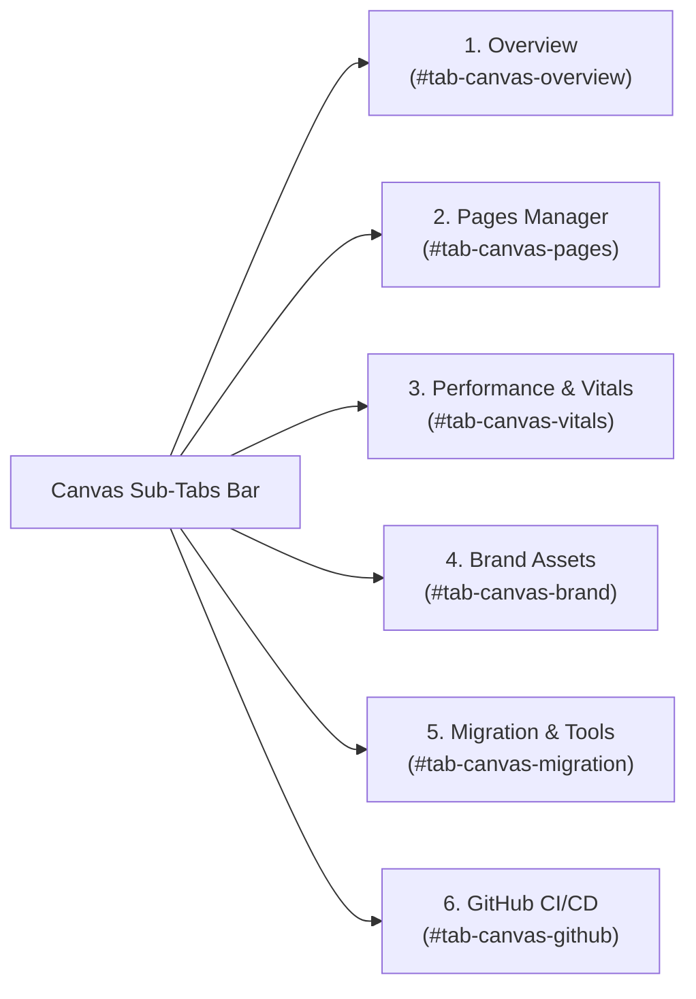

# Cora Platform — Canvas & Frontend Module Documentation (v4.9.419)

## Section 1: Overview & Multi-Engine Architecture

Cora Canvas is a unified frontend website and theme creation engine providing a 100% white-labeled builder experience for agencies and workspace owners. Hardened through **v4.9.419**, Canvas operates across eight core architectural engines:

1. **Engine A: White-Labeled Visual Drag-and-Drop Engine**: Operates within a sandboxed, two-row monochromatic toolbar (`cora-elementor-reskin.js` and `.css`), stripping out all CMS headers, admin chrome, upsell notices, and third-party references.
2. **Engine B: Visual HTML Canvas Engine (Lovable-Compatible)**: In-browser visual HTML editor rendering semantic HTML5/Tailwind inside an isolated sandboxed iframe (`#cora-html-canvas-iframe`) with inline `contenteditable` editing, media inventory scanning, 1-click image swapping, code-split editing, URL edit state persistence, and AI rewriting.
3. **Engine C: Universal Website Multi-Page Migrator Engine (`class-cora-html-website-migrator.php`)**: 1-click ingestion and crawler engine that scrapes external HTML/CSS/JS websites, downloads/isolates assets, sanitizes DOM code, and provisions editable draft themes.
4. **Engine D: Next.js & Expo Headless Static Build Engine (`class-cora-nextjs-integration.php`)**: Connects modern Next.js (App/Pages Router) and Expo React Native Web repositories via Git, providing dynamic GitHub tree scanning, public/private PAT authorization with dual-header fallback, automated static compilation into standalone distributions (`out/`, `dist/`), on-demand ISR webhooks, sub-150ms dev server probe detection, and cookie-isolated live preview proxies.
5. **Engine E: AI HTML & Tailwind Starter Engine (`cora_canvas_get_default_starter_html`)**: Delivers 6 production-calibrated industry landing page templates with 1-click prompt export for Claude & ChatGPT, dual-mode code connector (HTML paste / file dropzone), sandboxed live previews, and instant live launch with automatic CRM lead capture.
6. **Engine F: Self-Hosted Performance & Telemetry Decision Engine (`class-cora-performance-telemetry.php`)**: Cookieless, privacy-first, real-time website telemetry hub with passive RUM Core Web Vitals monitoring, 6-card Decision KPI Matrix, dynamic executive directive banner, and Google Search Console striking-distance keyword extractor (positions 4–15).
7. **Engine G: Dynamic Multi-Channel Template Engine (`class-cora-template-engine.php`)**: Decouples content entities from themes using `wp_cora_canvas_templates` across 5 fundamental archetypes: `article`, `page`, `policy`, `product`, and `collection` with structured layout slots.
8. **Engine H: Visual Node Workflow Canvas & Content Approval Drawer**: Interactive visual workflow surface wiring automation trigger nodes, AI processing engines (Claude, Gemini, ChatGPT), dynamic template renderers, and slide-out Content Approval Drawer with media selection bridge.

---

### Architecture Diagram

```mermaid
graph TD
    A[Cora Workspace Canvas UI] -->|Selects Action| B{Engine / Tool}
    B -->|Elementor Route| C[Elementor Reskinned Sandbox]
    B -->|Visual HTML Route| D[In-Browser Visual HTML Editor]
    B -->|Website Migration| E[Universal Multi-Page Crawler]
    B -->|Next.js Git Connect| F[Next.js Headless Engine]
    
    C -->|Injected Reskin| G[cora-elementor-reskin.js/css]
    C -->|Renders Layout| H[view-canvas-render.php]
    C -->|Saves Post Data| I[(wp_posts)]
    
    D -->|Iframe Preview| J[#cora-html-canvas-iframe]
    D -->|Inline Text Edit| K[contenteditable & outline]
    D -->|Code-Split View| L[Code Editor & Live DOM Sync]
    D -->|Asset Scanner| M[renderHtmlInventoryList]
    D -->|AI Rewrite & SEO| N[cora_ajax_canvas_ai_*]
    D -->|getCleanIframeHtml| O[Clean HTML Extraction]
    O -->|cora_ajax_save_html_visual| P[(wp_cora_canvas_pages)]
    
    E -->|Scrapes Domain| Q[class-cora-html-website-migrator.php]
    Q -->|Downloads Assets| R[Isolated Media Storage]
    Q -->|Sanitizes DOM| S[Strips Trackers / Ads]
    Q -->|Provisions Theme| T[(wp_cora_canvas_themes)]
    Q -->|Scaffolds Pages| P

    F -->|Scans Git Tree| U[GitHub REST API / PAT]
    F -->|Discovers Routes| V[App Router & Pages Router]
    F -->|Provisions Pages| P
    F -->|Headless REST| W[/wp-json/cora-canvas/v1/*]
    F -->|On-Demand ISR| X[Next.js /api/revalidate Webhook]
    F -->|Dev Server Probe| Y[Sub-150ms Ping & Proxy Frame]
    
    A -->|Manages| T
    A -->|Syncs Menus| Z[Navigation Menus]
```

---

## Section 2: Canvas Theme Builder & Lifecycle (v4.9.199 - v4.9.316)

The Theme Builder allows agencies to manage multiple design themes per workspace with complete tenant isolation (`agency_id = %d`). In **v4.9.199**, the Theme Builder underwent a comprehensive UX revamp into a unified single-stream interface, followed by Next.js app preview cards and level 2 routing in **v4.9.307 - v4.9.316**.

### 2.1 Single-Stream Theme Library (`#tab-canvas-overview`)
* **Unified Theme Stream**: Consolidates both draft templates and active production themes into a single continuous stream, eliminating awkward sub-view navigation and modal jumps.
* **Active vs. Draft State Badges**: Active themes display monochromatic high-contrast live badges (`bg-zinc-900 text-white dark:bg-white dark:text-zinc-900`), while draft themes render subtle tonal status indicators (`bg-zinc-100 text-zinc-700 dark:bg-zinc-800 dark:text-zinc-300`).
* **1-Tap Theme Activation**: Directly activate, preview, duplicate, or delete themes without full page reloads.

### 2.2 4-Card Speed & Core Web Vitals Diagnostic Strip
A dedicated diagnostic strip provides real-time telemetry on the active theme's web performance:
* **CWV Score**: Aggregate Google Core Web Vitals performance rating (e.g. `99/100`).
* **LCP Velocity**: Largest Contentful Paint render benchmark (e.g. `0.8s Target`).
* **Page Count**: Total published and staged canvas pages across the workspace.
* **Sync Quota**: Next.js Cloud deployment synchronization capacity.
* **1-Click "Optimize Now →" Recommendation Banner**: Inspects unoptimized imagery, render-blocking scripts, and missing CDN preloads, executing automated minification with a single click.

### 2.3 Edge-to-Edge Frosted Sticky Tabs (`#canvas-sticky-tabs-bar`)
* Pins cleanly below the global workspace header on scroll.
* Styled with `backdrop-blur-md bg-white/95 dark:bg-zinc-900/95` and subtle structural border (`border-b border-zinc-200/80 dark:border-zinc-800`).
* Flush edge-to-edge alignment (`px-0` on mobile viewports) eliminating horizontal scroll bleed.

### 2.4 Responsive Viewport Guard & Viewable-Only Mobile Mode
* **Desktop-First Builder**: Full visual iframe layout editing and split-code editing require precision mouse and keyboard control.
* **Mobile Guard (<768px)**: On mobile viewports, the canvas transitions to a read-only telemetry and status inspection mode. An elegant prompt encourages users to open on desktop screens for full canvas drag-and-drop manipulation.

### 2.5 Add Theme Wizard & Next.js Git Connector (v4.9.310)
The creation wizard provides quadruple visual cards:
* **Next.js Git Connector Card**: Connects GitHub repositories directly, discovering App Router pages and provisioning headless themes.
* **Elementor Builder Card**: Provisions Elementor container templates and theme parts.
* **Lovable / Visual HTML Builder Card**: Provisions lightweight, zero-dependency HTML5 templates with instantaneous render speeds.
* **Universal Website Migrator Card**: Ingests external websites directly into draft themes.
* **Wizard Reset Engine**: `window.wizardResetCards()` cleanly resets card active states upon closing or reopening the modal.

### 2.6 Next.js App Preview Card in Canvas Level 1 (v4.9.316)
When an active theme uses the Next.js engine (`source = 'nextjs'`), the Canvas overview Level 1 renders an ultra-modern, high-density Next.js App Preview Mockup card:
* **Browser Top Chrome**: 3-dot window buttons, Next.js brand pill, monospace URL preview, and external tab launcher.
* **Status & Router Badges**: Active emerald status indicator (`Active 🟢`) with animated pulse alongside an `App Router` framework tag.
* **Connected Repository Details**: Displays GitHub repository path and active branch chip (`main`).
* **Scanned Route Chips**: Displays primary scanned routes (`/`, `/about`, `/contact`, `+N more`) extracted by the Git scanner.
* **Direct Quick-Actions**: "Open Live Site" and "Dev SDK & Ops" buttons for 1-tap workflow acceleration.

### 2.7 Level 2 Live Theme Customizer & Sidebar Hover Quick-Actions (v4.9.305 - v4.9.307)
* **Sidebar Hover Quick-Actions**: Hovering over the Canvas navigation item in the sidebar reveals instant action triggers:
  - **Pen Icon (`Edit Live Theme`)**: Invokes `window.coraOpenLiveThemeCustomizer()` to immediately launch the Level 2 Live Theme Customizer for the active live theme, eliminating multi-click navigation through Level 1.
  - **External Link Icon (`View Live Site`)**: Launches the live site in a new tab.
* **Event Scoping**: Click handlers prevent event bubbling (`e.stopPropagation()`) to maintain seamless sidebar navigation.

---

## Section 3: Universal Website (HTML/CSS/JS) Multi-Page Migrator Engine (v4.9.58 - v4.9.59)

The Universal Website Migrator (`class-cora-html-website-migrator.php`) enables instantaneous website ingestion into Cora Canvas:

```
+-----------------------------------------------------------------------------------+
|                        UNIVERSAL WEBSITE MIGRATION PIPELINE                       |
+-----------------------------------------------------------------------------------+
|  [ 1. URL Ingestion & Domain Guard ]  --->  Validates domain & prevents recursion  |
|  [ 2. Multi-Page DOM Crawler ]        --->  Discovers internal links (< 25 pages) |
|  [ 3. Asset Downloader & Localizer ]  --->  Fetches CSS, JS, Fonts & Images       |
|  [ 4. DOM Cleaner & Security Shield]  --->  Strips trackers, ads, scripts         |
|  [ 5. Draft Theme Scaffolding ]       --->  Creates theme in wp_cora_canvas_themes|
|  [ 6. Visual Canvas Rendering ]       --->  Opens directly in Visual HTML Editor  |
+-----------------------------------------------------------------------------------+
```

### 3.1 Migration Workflow & Sequence
1. **Target Validation**: Workspace owner inputs public URL (e.g. `https://agency-sample.com`), selects scan depth (1-5), and sets maximum page limits.
2. **Recursive Domain Crawling**: The engine extracts all internal hyperlinks matching the root domain host while filtering out anchor fragments, external social links, file downloads (`.pdf`, `.zip`), and JavaScript template strings.
3. **Asset Isolation & Local Bundling**:
   - Downloads linked CSS stylesheets and extracts embedded `@import` and `url()` references.
   - Downloads images (``, `srcset`, inline CSS `background-image`) and places them into isolated workspace upload directories.
   - Rewrites HTML references to localized paths.
4. **HTML Sanitization & Body Preservation**:
   - Preserves complete document structure, CSS variables, and layout classes.
   - Strips malicious scripts, external analytics (Google Analytics, Meta Pixel), tracking iframes, and external advertising widgets.
5. **Draft Theme Creation**: Registers a new theme record in `wp_cora_canvas_themes` (`engine='lovable'`, `status='draft'`) and populates all crawled pages in `wp_cora_canvas_pages`.
6. **Instant Visual Editing**: Directly launches the newly migrated theme in the Visual HTML Editor for immediate text, image, and styling modifications.

### 3.2 Streamlined Monochromatic Migration UI
* Dedicated migration drawer/modal with dark blurred backdrop overlay (`rgba(9,9,11,0.45)`).
* Real-time progress bar and step indicators (*Analyzing Domain* → *Crawling Pages* → *Bundling Assets* → *Generating Canvas Pages*).
* Live terminal-style status readout.

---

## Section 4: In-Browser Visual HTML Editor Engine

The Visual HTML Canvas Engine allows rapid editing of static, AI-generated, and migrated HTML pages directly in the browser:

```
+-----------------------------------------------------------------------------------+
|                           VISUAL HTML CANVAS EDITOR                               |
+------------------------------------+----------------------------------------------+
|       Sidebar Controls             |            Live Iframe Canvas                |
|  • Device Switcher (Mobile/Desktop)|  [ Header: "Modern Creative Studio" ]        |
|  • Media Asset Inventory List      |    (Click to edit text directly inline)      |
|  • Image Swapper Modal Launcher    |  [ Hero Image:  ]        |
|  • AI Element Rewriting Drawer     |    (Hover -> "Swap Image" indicator)         |
|  • Code-Split Mode Toggle          |  [ CTA: "Book Consultation" ]                |
+------------------------------------+----------------------------------------------+
|               Bottom Dock: [ Code Split ]  [ AI Insights ]  [ Save & Publish ]    |
+-----------------------------------------------------------------------------------+
```

### 4.1 Live Iframe Sandboxing
HTML pages load inside an isolated `<iframe>` (`#cora-html-canvas-iframe`) to prevent style collisions between the platform dashboard UI and the client website theme.

### 4.2 Real-Time Inline `contenteditable` Editing
* Clicking any text element (`<h1>`–`<h6>`, `<p>`, `<span>`, `<a>`, `<button>`) inside the iframe enables `contenteditable="true"`.
* Active elements display a subtle monochromatic focus outline (`outline: 2px solid #18181b; outline-offset: 2px`).
* Changes are mirrored in memory immediately.

### 4.3 Code-Split Editor Mode & URL Edit State Persistence
* **Code-Split Mode**: Toggle between purely visual canvas and split-screen HTML source code editor with instant bidirectional live updates.
* **URL State Persistence**: Maintains the active page ID and edit mode in the browser query string (`?page_id={id}&edit_mode=visual`), preventing loss of work across page reloads.

### 4.4 Media Asset Inventory Scanner (`renderHtmlInventoryList`)
* On load, the editor parses all `` tags inside the iframe DOM.
* Generates an interactive thumbnail gallery in the left sidebar showing image dimensions, aspect ratios, and current `src` attributes.

### 4.5 1-Click Image Replacement Modal (`openImageReplacerPopover`)
* Clicking any image in the iframe or sidebar inventory opens `#cora-image-replacer-popover`.
* Allows picking images from the **Cora Media Library** or specifying an external URL.
* Instantly updates the iframe DOM node in real-time.

### 4.6 Clean HTML Extraction Engine (`getCleanIframeHtml`)
To prevent editor state tags from leaking into production:
1. Clones the iframe document DOM.
2. Strips all `contenteditable` attributes.
3. Removes `.cora-editing-active`, temporary highlight wrappers, and editor instrumentation classes.
4. Returns clean, valid, production-ready HTML5 markup.

### 4.7 Canvas Route Isolation Engine
* Ensures public Canvas theme frontend routes (`/page/{slug}`, `/theme-preview`) operate in complete isolation from internal workspace subview routes (`/workspace/{subpage}`).

---

## Section 5: AI-Powered Canvas Tools

### 5.1 AI Element Rewriter (`cora_ajax_canvas_ai_rewrite_element`)
* Re-drafts selected headlines, subtext, and call-to-actions.
* Supports 4 contextual tones:
  - *Punchy & Direct*
  - *Professional & Trustworthy*
  - *High-Converting / Sales-Focused*
  - *Minimalist & Modern*

### 5.2 Automated Core Web Vitals & SEO Optimizer (`cora_ajax_canvas_ai_optimize_page`)
* Evaluates page markup against Google Core Web Vitals standards:
  - **LCP (Largest Contentful Paint)**: Injects `fetchpriority="high"` and preloads above-the-fold hero images.
  - **CLS (Cumulative Layout Shift)**: Ensures explicit `width` and `height` attributes on all images.
  - **FID / INP**: Optimizes inline script loading with `defer`.
  - **SEO**: Scans and optimizes OpenGraph meta tags, canonical links, and structured JSON-LD data.

---

## Section 6: Elementor White-Labeling Engine

For complex visual layouts, Elementor is wrapped in a dedicated white-label skin:
* Injects `cora-elementor-reskin.js` and `cora-elementor-reskin.css`.
* Suppresses default legacy admin bars, logos, help popovers, and promotional up-sell banners.
* Injects a dual-row monochromatic top bar with Workspace navigation, Draft/Live status toggles, device preview switchers, and Git commit actions.

---

## Section 7: Database Schema

### 7.1 Themes Table (`wp_cora_canvas_themes`)
```sql
CREATE TABLE wp_cora_canvas_themes (
    id bigint(20) unsigned NOT NULL AUTO_INCREMENT,
    agency_id bigint(20) unsigned NOT NULL,
    name varchar(255) NOT NULL,
    engine varchar(50) NOT NULL DEFAULT 'lovable', -- 'lovable' | 'elementor'
    status varchar(50) NOT NULL DEFAULT 'draft',   -- 'draft' | 'live'
    settings longtext DEFAULT NULL,                -- JSON: fonts, colors, CSS, header_id, footer_id
    created_at datetime DEFAULT CURRENT_TIMESTAMP,
    updated_at datetime DEFAULT CURRENT_TIMESTAMP,
    PRIMARY KEY (id),
    KEY agency_id (agency_id)
);
```

### 7.2 Pages Table (`wp_cora_canvas_pages`)
```sql
CREATE TABLE wp_cora_canvas_pages (
    id bigint(20) unsigned NOT NULL AUTO_INCREMENT,
    agency_id bigint(20) unsigned NOT NULL,
    theme_id bigint(20) unsigned NOT NULL,
    wp_post_id bigint(20) unsigned DEFAULT NULL,
    title varchar(255) NOT NULL,
    slug varchar(255) NOT NULL,
    template varchar(50) NOT NULL DEFAULT 'standard',
    html_content longtext DEFAULT NULL,            -- Visual HTML Engine content
    is_homepage tinyint(1) NOT NULL DEFAULT 0,
    seo_title varchar(255) DEFAULT NULL,
    seo_description text DEFAULT NULL,
    seo_og_image varchar(255) DEFAULT NULL,
    created_at datetime DEFAULT CURRENT_TIMESTAMP,
    updated_at datetime DEFAULT CURRENT_TIMESTAMP,
    PRIMARY KEY (id),
    KEY agency_id (agency_id),
    KEY theme_id (theme_id)
);
```

---

## Section 8: AJAX & Headless REST API Reference

### 8.1 AJAX Actions Registry

| Action | Endpoint / Hook | Parameters | Description |
| :--- | :--- | :--- | :--- |
| **Migrate Website** | `cora_ajax_canvas_migrate_website` | `target_url`, `crawl_depth`, `max_pages`, `nonce` | Ingests external site, localizes assets, and provisions draft theme. |
| **Migration Status** | `cora_ajax_canvas_get_migration_status`| `job_id`, `nonce` | Returns real-time crawler progress and page count. |
| **Delete Theme** | `cora_ajax_canvas_delete_theme` | `theme_id`, `nonce` | Securely removes draft theme and associated canvas pages. |
| **Create Theme** | `cora_ajax_create_canvas_theme` | `name`, `engine`, `nonce` | Provisions a new theme in `draft` status. |
| **Publish Theme** | `cora_ajax_publish_canvas_theme` | `theme_id`, `nonce` | Sets theme to `live` and demotes prior live theme. |
| **Save Theme Settings**| `cora_ajax_save_canvas_settings` | `theme_id`, `settings_json`, `nonce` | Saves typography, colors, global CSS. |
| **Create Page** | `cora_ajax_create_canvas_page` | `theme_id`, `title`, `slug`, `template` | Provisions Canvas page and mapped `wp_posts` entry. |
| **Save Visual HTML** | `cora_ajax_save_html_visual` | `page_id`, `html_content`, `nonce` | Extracts clean HTML and commits to database. |
| **Get HTML Page Data**| `cora_ajax_get_html_page_data` | `page_id`, `nonce` | Returns raw HTML and SEO metadata for editor. |
| **AI Element Rewrite**| `cora_ajax_canvas_ai_rewrite_element`| `element_text`, `tone`, `prompt` | Returns AI rewritten copy variants. |
| **AI SEO / CWV Optimize**| `cora_ajax_canvas_ai_optimize_page`| `page_id`, `html_content` | Performs automated Core Web Vitals optimizations. |
| **Create Nav Menu** | `cora_ajax_create_nav_menu` | `menu_name`, `items_json`, `nonce` | Synchronizes navigation menu with backend menu store. |
| **Scan Next.js Routes** | `cora_nextjs_scan_routes` | `repo`, `branch`, `pat`, `nonce` | Scans GitHub repo tree for App/Pages Router routes. |
| **Trigger ISR Revalidation** | `cora_nextjs_trigger_isr` | `theme_id`, `path`, `nonce` | Calls remote Next.js ISR revalidation webhook with secret. |
| **Save Page Props** | `cora_nextjs_save_page_props` | `page_id`, `theme_id`, `props`, `auto_revalidate`, `nonce` | Commits headless props JSON and optionally triggers live ISR. |
| **Sync Git Repo** | `cora_nextjs_sync_repo` | `theme_id`, `nonce` | Resyncs linked GitHub repo tree and updates Canvas pages. |
| **Save Next.js Live URL** | `cora_nextjs_save_live_url` | `theme_id`, `live_url`, `nonce` | Updates local development server or production deployment URL. |

### 8.2 Headless REST API Endpoints (`/wp-json/cora-canvas/v1/`)

| Method | Endpoint | Query / Body Parameters | Description |
| :--- | :--- | :--- | :--- |
| `GET` | `/cora-canvas/v1/nextjs/manifest` | `theme_id` (optional) | Returns site tokens, theme configuration, navigation, and all registered routes. |
| `GET` | `/cora-canvas/v1/nextjs/page` | `slug` / `route` / `id`, `theme_id` | Returns props JSON, SEO tags, OpenGraph metadata, and canonical URLs for a single route. |
| `POST` \| `GET` | `/cora-canvas/v1/nextjs/revalidate` | `secret`, `path`, `theme_id` | Dispatches on-demand ISR revalidation trigger to live Next.js deployment `/api/revalidate`. |
| `POST` | `/cora-canvas/v1/nextjs/forms/submit` | `name`, `email`, `phone`, `message`, `source`, `form_id` | Ingests frontend lead inquiry directly into Cora Leads CRM (`wp_cora_leads`). |

---

## Section 9: Next.js Headless Integration Engine & GitHub App Router Scanner (v4.9.308 - v4.9.316)

The Next.js Native & Headless Integration Engine (`class-cora-nextjs-integration.php`) establishes a bi-directional bridge between modern Next.js frontends (Next.js 14/15 App Router and Pages Router) and the Cora SaaS Workspace.

```
+-----------------------------------------------------------------------------------+
|                     CORA NEXT.JS HEADLESS INTEGRATION LIFECYCLE                   |
+-----------------------------------------------------------------------------------+
|  [ 1. GitHub PAT Auth & Dual Fallback ] ---> Connects repository with Bearer/token |
|  [ 2. Branch & Recursive Tree Scan ]   ---> Scans app/**/page.tsx excluding groups |
|  [ 3. Route Ingestion & Props Storage] ---> Auto-registers pages in Canvas DB      |
|  [ 4. Headless REST Manifest Stream ]  ---> Supplies tokens, routes & props to app|
|  [ 5. On-Demand ISR Webhook Hook ]     ---> POST /api/revalidate on content save   |
|  [ 6. Sub-150ms Dev Probe & Proxy ]    ---> Fast localhost:3000 offline detection  |
+-----------------------------------------------------------------------------------+
```

### 9.1 Headless Architecture & Class Structure (`class-cora-nextjs-integration.php`)
* **Singleton Lifecycle**: Instantiated via `Cora_NextJS_Integration::get_instance()`, hooking into framework `rest_api_init` and registering administrative AJAX actions.
* **Namespace Standardization**: Standardized on REST namespace `cora-canvas/v1`, exposing dedicated headless endpoints for theme manifests, page props, ISR revalidation, and CRM form submission.

### 9.2 GitHub App Router Tree Scanner & Dynamic Branch Discovery
The GitHub tree scanner (`Cora_NextJS_Integration::scan_repository_routes`) automatically maps Next.js application routes directly from remote Git repositories:
1. **Repository Slug Resolution**: Accepts standard formats (`owner/repo`, `https://github.com/owner/repo`, or `.git` URLs).
2. **Dynamic Branch Discovery**:
   - Queries `https://api.github.com/repos/{owner}/{repo}/branches?per_page=100`.
   - Discovers all active branches and automatically selects the repository's default branch (`main` or `master`) when no specific branch is requested.
3. **Recursive Tree Inspection**:
   - Fetches the full repository tree via `https://api.github.com/repos/{owner}/{repo}/git/trees/{branch}?recursive=1`.
4. **App Router Route Extraction**:
   - Inspects file paths with regex: `#^(?:.+/)?(?:src/)?app/(.+/)?page\.(tsx|jsx|js|ts)$#i`.
   - **Route Group Filtering**: Automatically detects and strips route group folder segments (e.g. `(marketing)`, `(auth)`, `(dashboard)`) to ensure clean canonical routing:
     - Input path: `app/(marketing)/about/page.tsx`
     - Output clean route: `/about`
     - Output slug: `about`
   - **Dynamic Route Detection**: Flags dynamic routes containing brackets (e.g. `[slug]`, `[id]`, `[...catchall]`).
5. **Pages Router Fallback**:
   - Inspects legacy paths via regex: `#^(?:.+/)?(?:src/)?pages/(.+)\.(tsx|jsx|js|ts)$#i`.
   - Automatically excludes framework internals (`_app`, `_document`, `_error`, and `api/`).
6. **Homepage Guarantee**:
   - Automatically designates `/` as `is_homepage = 1`, ensuring root URL resolution always maps to the primary landing page.

### 9.3 Public & Private Repository Support via Dual Authorization Header Fallback
To support both public repositories and secured private agency codebases:
* **PAT Secure Storage**: Accepts GitHub Personal Access Tokens (Classic or Fine-Grained), storing them securely in `cora_git_sync_token` options and user meta.
* **Dual Header Fallback Strategy**:
  - GitHub Classic PATs require `token <pat>`, whereas GitHub Fine-Grained PATs prefer `Bearer <pat>`.
  - On dispatching requests to `api.github.com`, if an HTTP 401 (Unauthorized) or HTTP 404 (Not Found on private repos) is encountered, the scanner automatically toggles between `Bearer ` and `token ` headers before reporting failure:
    ```php
    // Automatic retry with alternative header format
    $alt_headers = $headers;
    $alt_headers['Authorization'] = ( str_starts_with( $headers['Authorization'], 'Bearer ' ) ? 'token ' : 'Bearer ' ) . $pat;
    $alt_resp = wp_remote_get( $url, array( 'headers' => $alt_headers, 'timeout' => 15 ) );
    ```
* **Graceful Permission Diagnostics**: Returns clear, actionable guidance if the PAT lacks required scopes (`repo` for Classic PATs or `Contents: Read-only` for Fine-Grained PATs).

### 9.4 Route Metadata Extraction & Page Props Editing
* **Database Ingestion**: Discovered routes are synchronized directly into `wp_cora_canvas_pages` linked to the active theme ID.
* **Structured Props Storage (`_cora_nextjs_props`)**:
  - Custom props, hero copy, feature lists, pricing data, and configuration blocks are persisted in post meta under `_cora_nextjs_props`.
  - Level 2 Theme Customizer provides an interactive visual JSON inspector and props editor.
* **Automatic Cache Invalidation**: When props are updated with `auto_revalidate = 1`, the editor automatically initiates an on-demand ISR revalidation for that route.

### 9.5 Headless REST API Suite Contracts

#### 1. Theme Manifest Endpoint (`GET /wp-json/cora-canvas/v1/nextjs/manifest`)
Supplies design tokens, global branding, and the full page index to Next.js clients:
```json
{
  "success": true,
  "theme": {
    "id": 1,
    "name": "Studio Production Next.js",
    "status": "live",
    "source": "nextjs",
    "repo": "cora/studio-starter",
    "branch": "main",
    "live_url": "http://localhost:3000"
  },
  "site": {
    "title": "Cora Studio Workspace",
    "tagline": "Modern Creative Production SaaS",
    "logo": "https://assets.cora.local/logo.svg",
    "favicon": "https://assets.cora.local/favicon.ico",
    "copyright": "© 2026 Cora. All rights reserved."
  },
  "tokens": {
    "primary": "#18181b",
    "secondary": "#27272a",
    "accent": "#10b981",
    "text": "#09090b",
    "bg": "#ffffff",
    "heading_font": "Inter",
    "body_font": "Inter"
  },
  "pages": [
    {
      "id": 101,
      "title": "Home",
      "slug": "home",
      "route": "/",
      "is_homepage": true,
      "status": "publish",
      "seo": {
        "title": "Home — Cora Studio",
        "description": "Creative agency workspace platform.",
        "og_image": "https://assets.cora.local/og-cover.png"
      },
      "props": {
        "hero_title": "Scale Your Studio Operations",
        "cta_label": "Explore Platform"
      },
      "updated_at": "2026-10-02 18:30:00"
    }
  ],
  "api_version": "1.0.0",
  "generated_at": "2026-10-02T18:30:00+00:00"
}
```

#### 2. Single Page Props & SEO Endpoint (`GET /wp-json/cora-canvas/v1/nextjs/page`)
Accepts `?route=/about` or `?slug=about` or `?id=102`, returning exact route props and OpenGraph metadata.

#### 3. Lead Form Submission Endpoint (`POST /wp-json/cora-canvas/v1/nextjs/forms/submit`)
Allows Next.js client forms (`<ContactForm />`, lead capture modals) to submit directly into Cora CRM:
* **Payload**: `{ "name": "Rohan Verma", "email": "rohan@example.com", "phone": "+91 98765 43210", "message": "Inquiry regarding studio booking.", "source": "Next.js Frontend" }`.
* **CRM Ingestion**: Inserts record into `wp_cora_leads` with `status='new'`, records tenant activity logs, and dispatches in-app notifications.

### 9.6 On-Demand Incremental Static Regeneration (ISR) Webhook Trigger
To ensure instant edge CDN cache invalidation without triggering full Next.js project rebuilds:
1. **Webhook Contract**: Dispatches POST requests to `{live_url}/api/revalidate?secret={secret}&path={path}`.
2. **Next.js Route Handler Implementation**:
   ```typescript
   // Next.js app/api/revalidate/route.ts
   import { revalidatePath } from 'next/cache';
   import { NextRequest, NextResponse } from 'next/server';

   export async function POST(request: NextRequest) {
     const secret = request.nextUrl.searchParams.get('secret');
     const path   = request.nextUrl.searchParams.get('path') || '/';

     if (secret !== process.env.CORA_REVALIDATE_SECRET) {
       return NextResponse.json({ message: 'Invalid token' }, { status: 401 });
     }

     revalidatePath(path);
     return NextResponse.json({ revalidated: true, path, now: Date.now() });
   }
   ```
3. **Execution Diagnostics**: Cora Canvas records roundtrip latency (`duration_ms`), HTTP response status, and diagnostic error output directly in the editor notification stream.

### 9.7 Live Dev Server Detection & Preview Proxy Engine
When running local development environments (`http://localhost:3000` or `http://127.0.0.1:3000`):
1. **Fast Sub-150ms Probe Detection**:
   - Rather than letting browser iframes hang on connection timeouts, `cora_render_nextjs_live_frame` runs an instantaneous probe via `fetch`:
     ```javascript
     if (window.fetch && window.CORA_NEXTJS_LIVE_URL) {
         fetch(window.CORA_NEXTJS_LIVE_URL, { mode: 'no-cors', cache: 'no-store' })
             .then(function() { /* Dev server reachable */ })
             .catch(function(err) { showOffline(); });
     }
     ```
2. **Local Dev Server Offline Card Overlay (`#cora-error-overlay`)**:
   - When the dev server is unreachable, `showOffline()` activates within 150ms.
   - Renders a focused dark blurred modal card featuring:
     - Headline: `Local Dev Server Offline`
     - Terminal Instruction Block: `$ npm run dev` with 1-click clipboard copy.
     - Presets Switcher: Quick chips for `localhost:3000`, `127.0.0.1:3000`, and `localhost:3001`.
     - Direct external launcher: `Open localhost:3000 ↗`.
3. **Next.js Proxy Router (`cora_canvas_theme_frontend_router`)**:
   - In `cora-workspace.php`, the frontend router inspects active and preview themes.
   - If the theme source is `nextjs`, it renders `cora_render_nextjs_live_frame()` or `cora_render_nextjs_connector_screen()` immediately, completely eliminating random default template fallbacks.
4. **Bidirectional PostMessage Bridge**:
   - The host workspace communicates with the child Next.js iframe using `postMessage`:
     - `CORA_INIT`: Transmits API URL, REST nonces, theme ID, and initial route.
     - `CORA_ROUTE_CHANGE`: Child frame informs host workspace of internal client navigation, seamlessly updating the browser address bar.
     - `CORA_GET_CONFIG` / `CORA_CONFIG_RESPONSE`: Provides dynamic runtime workspace variables to the frontend.

### 9.8 Preview Cookie Isolation Architecture (`cora_preview_theme_id` / `cora_canvas_preview`)
To prevent development preview sessions from interfering with production workspace traffic:
1. **Explicit Parameter Scoping**:
   - Preview mode is strictly activated when an explicit query parameter is provided (`?preview_canvas=...` or `?preview=1` or `?cv_preview_theme=...`).
2. **Cookie Purge on Normal Traffic**:
   - In `cora_get_preview_theme_id()`, if a request arrives on `/site/` without explicit preview query parameters, and a live production theme exists, the system automatically deletes the preview cookie:
     ```php
     if ( ! headers_sent() ) {
         setcookie( 'cora_preview_theme_id', '', time() - 3600, '/' );
     }
     unset( $_COOKIE['cora_preview_theme_id'] );
     $raw_theme_id = 0;
     ```
   - Guarantees that public users and regular workspace visitors always view the active live theme without state leakage.

---

## Section 10: Next.js Frontend Integration & Optimization (`cora-frontend`)

Cora maintains an independent, high-performance marketing and client frontend (`cora-frontend`) powered by Next.js and Tailwind CSS:

### 10.1 3-Tier Interactive Pricing Alignment
* Matches the SaaS monetization structure across Starter, Growth, and Enterprise tiers.
* Real-time billing toggle (Monthly / Annual with 20% discount badge).
* Clear feature entitlement breakdown (AI Runes, Workspace seats, custom domains, CRM contacts).

### 10.2 Image Optimization & WebP Asset Compression
* Next.js Image Component (`next/image`) integration with native Sharp (`sharp@0.35.4`) optimization.
* Dynamic WebP transcoding on ingestion, reducing asset payload size by up to 68%.
* Responsive `srcset` generation and automatic placeholder blurs (`blurDataURL`).

### 10.3 Security & Dependency Hardening (v4.9.209 - v4.9.316)
* Upgraded to Next.js `16.3.3` to remediate upstream CVE advisories in dev server routing and image optimization endpoints.
* Isolated environment variable loading (`.env.local`) strictly preventing API secret exposure to client browser bundles.

---

## Section 11: AI HTML & Tailwind Starter Prompts Grid & 10-Min Zero-Build Launch (v4.9.334 - v4.9.337)

The Add Theme Wizard (Step 2: Architecture & Template Selection) prioritizes modern **AI HTML & Tailwind** workflows:

### 11.1 Curated 5-Template Production Prompts Grid
1. **Creative Agency & Video Production Studio (`agency`)**:
   - Monochromatic design language, cinematic full-viewport hero section, marquee client logo ticker, 3-column project showcase with hover video previews, dynamic testimonials, and project brief request form.
2. **AI SaaS & Software Landing (`saas`)**:
   - Modern dark hero background (`#09090b`), interactive product mockup preview box, 6-card feature grid, live pricing toggle (Monthly / Annual with 20% discount), and instant trial lead capture.
3. **B2B Advisory & Management Consulting (`consulting`)**:
   - Institutional editorial typography, strategic practice areas (M&A, Restructuring, Private Capital), partner credentials matrix, downloadable industry whitepaper CTA, and confidential advisory audit booking form.
4. **Commercial Photography Studio & Production House (`photography`)**:
   - High-density masonry gallery layout, client proofing portal spotlight, interactive photoshoot booking date/slot selector, and equipment gear inventory showcase.
5. **Custom Niche Enterprise Studio (`custom`)**:
   - Clean, modular component architecture adaptable to specialized local business verticals.

### 11.2 1-Click Prompt Extraction for Claude & ChatGPT
* Each prompt template card features a 1-click `📋 Copy Prompt for Claude / ChatGPT` button.
* Formulates a specialized master system prompt instructing LLMs to generate:
  - Single-file pure HTML5 markup.
  - Tailwind CSS via CDN (`https://cdn.tailwindcss.com`).
  - Lucide vector SVG icons.
  - Native Cora lead form hooks (`action="/wp-json/cora-canvas/v1/nextjs/forms/submit"`).
* **Script Tag Escape Sanitization (v4.9.337)**: All prompt templates dynamically escape closing script tags (`<\/script>`) in PHP rendering, preventing HTML parser syntax collisions.

### 11.3 Dual-Mode Code Connector & Live Sandboxed Launch
* **Direct Code Paste / Dropzone**: Users can paste raw HTML directly into a textarea or drag-and-drop `.html` or `.zip` bundles.
* **Instant Sandboxed Preview**: Renders the pasted code inside a scaled 1280x760 iframe sandbox for immediate visual verification before committing.
* **10-Minute Launch**: Theme creation, page scaffolding, and live route provisioning execute atomically without requiring build servers or terminal setups.

---

## Section 12: Automated Static Site Compiler, Exporter Pipeline & Shared Hosting Resilience (v4.9.317 - v4.9.331)

### 12.1 Automated Repository Build Engine (`cora_nextjs_build_repo`)
* Connects to GitHub repositories and compiles modern JavaScript frameworks directly on the hosting server using a dedicated runner process (`proc_open`).
* Auto-detects frameworks: Next.js (App & Pages Router), Expo React Native Web, Vite, and React SPA.
* Produces clean, zero-dependency static distributions (`out/`, `dist/`, `build/`).

### 12.2 Static Asset Streaming Router (`cora_render_nextjs_static_build`)
* Intercepts incoming web requests on `init` (priority 1) in `cora-workspace.php`.
* Streams static JS/CSS assets (`/_next/*`, `/_expo/*`, `/brand/*`) directly with correct Content-Type headers, HTTP 304 ETag validation, and immutable cache lifecycles (`Cache-Control: public, max-age=31536000, immutable`).

### 12.3 CloudLinux & Shared Hosting Hardening
* **Inode Quota Auto-Recovery (`-122 EDQUOT`)**: Proactively purges stale npm caches (`~/.npm/_cacache`) and inactive build directories.
* **Directory Rename Lock Self-Healing (`ENOTEMPTY`)**: Automatic retry fallback: `npm install --no-audit || (rm -rf node_modules package-lock.json && npm install)`.
* **Low-Memory Webpack Optimization**: Passes `NODE_OPTIONS="--max-old-space-size=768"` and `RAYON_NUM_THREADS=1` to prevent `SIGKILL` termination.
* **WebAssembly Memory Trap Flags**: `--no-wasm-code-gc` and `--disable-wasm-trap-handler` prevent Undici/llhttp allocation crashes.
* **Real-Time 5-Step Build Terminal**: Streams live compilation logs in Step 3 of the Add Theme Wizard with root-cause diagnostic cards and 1-click `⚡ Retry Build`.

---

## Section 13: Universal Lead Form Ingestion & Live Site CRM Interception Engine (v4.9.333 - v4.9.335)

### 13.1 Lead CRM Bridge Architecture
Static websites hosted on Cora automatically bridge to the workspace CRM (`wp_cora_leads`):
* **Automatic Script Injection**: When serving static pages via `cora_render_nextjs_static_build()`, Cora injects a lightweight client-side form interception script.
* **Intercepted Form Selectors**:
  - Any standard HTML form targeting `/wp-json/cora-canvas/v1/nextjs/forms/submit` or `#cora-contact-form`.
  - Embedded Cora Form widgets (`.cora-form-embed`).
* **Instant Feedback**: Submissions display an in-place monochromatic confirmation toast and card without reloading or breaking static site navigation.

---

## Section 14: Security Hardening, Path Containment & HTTP Asset Caching Pipeline (v4.9.337)

### 14.1 Strict `realpath` Path Containment
* Validates every requested static asset path against the real root directory (`realpath($static_dir)`).
* Rejects any path traversing outside the directory boundaries, preventing directory traversal attacks.

### 14.2 ZipArchive Extraction Sanitization
* Unpacking `.zip` theme uploads iterates over archive indices, rejecting entries containing `../` or `..\`.
* Validates destination paths before file creation.

### 14.3 HTTP 304 Not Modified Caching
* Generates deterministic ETags (`md5($path . $filemtime)`).
* Responds with HTTP 304 Not Modified when matching `HTTP_IF_NONE_MATCH` headers are received.

### 14.4 Capability Gatekeeping
* Enforces `edit_theme_options` and `manage_options` across all Next.js route scanning, ISR triggering, and page property mutations.

---

## Section 15: Turnkey Official ChatGPT Plugin & Remote MCP 2.0 Ecosystem (v4.9.334)

### 15.1 Package Overview (`cora-chatgpt-plugin/`)
* **`manifest.json` / `ai-plugin.json`**: Official OpenAI plugin manifest.
* **`openapi.json`**: Complete OpenAPI 3.0.1 specification defining 28 curated tools.
* **`mcp.json`**: Remote Model Context Protocol 2.0 server configuration.
* **`skills/`**: Core workflow prompts for CRM Leads, GST Invoicing, Bookings, and Operations Copilot.

---

## Section 16: Add Theme Wizard UI Overhaul (Active-Voice 2x2 Grid & Production Templates, v4.9.344 - v4.9.345)

### 16.1 Active-Voice 2x2 Engineering Grid
Replaces passive, ambiguous options with four explicit, action-driven paths:
1. **Build with AI Prompts**: Calibrated HTML/Tailwind starter prompts with 1-click clipboard copying for Claude and ChatGPT, dual-mode code connector, and 1-click live launch.
2. **Connect Headless Code**: Link production Next.js and Expo React Native Web Git repositories with dynamic route discovery and automated static site compilation.
3. **Scrape & Migrate Website**: 1-click multi-page crawler that ingests any live URL, downloads and isolates assets, sanitizes DOM code, and provisions editable draft themes.
4. **White-Labeled Visual Builder**: Launch sandboxed visual drag-and-drop builder in an isolated workspace with a custom two-row monochromatic toolbar and zero CMS admin chrome.

### 16.2 Edge-to-Edge Sticky Bottom Bar
Modal action controls anchor permanently to the bottom of the viewport (`sticky bottom-0 bg-white border-t border-zinc-200`) with high-contrast `Cancel` and `Continue` buttons, preventing layout shifts or obscured CTA triggers on smaller laptop screens.

### 16.3 Real-Time Template Search Filter
In Step 2, a responsive search input dynamically filters template cards by name and description without reloading or DOM destruction.

### 16.4 6 Production Template Presets with Realistic Preview Assets
Step 2 includes 6 pre-built, production-calibrated industry layouts accompanied by high-fidelity screenshot assets (`assets/img/tmpl_*`):
* **Creative Agency & Video Production Studio** (`tmpl_agency_preview.jpg`): High-contrast portfolio, showreel banner, client proofing links, and brief request intake.
* **Management Consulting & Advisory** (`tmpl_consulting_preview.jpg`): Editorial corporate layout, practice areas, partner credentials, and executive advisory booking.
* **E-Commerce Direct-to-Consumer Store** (`tmpl_ecommerce_preview.jpg`): High-converting product showcase, feature callouts, customer reviews, and cart hooks.
* **Commercial Photography Studio & Production House** (`tmpl_photography_preview.jpg`): Masonry visual gallery, shoot package comparison, and booking intake screener.
* **Luxury Real Estate Brokerage** (`tmpl_realestate_preview.jpg`): Property showcase cards, neighborhood highlights, agent roster, and showing request forms.
* **Modern B2B AI SaaS Platform** (`tmpl_saas_preview.jpg`): Interactive product UI preview card, feature grid, 3-tier pricing matrix, and lead capture.

### 16.5 Zero-Emoji Standard
All labels, descriptions, and wizard cards strictly utilize thin-lined vector SVGs (`stroke-width: 1.8`) to uphold the Cora Design System.

---

## Section 17: Standardized Canvas Drawers & Overflow Locking Standard (v4.9.352 - v4.9.353)

### 17.1 Unified Side Drawer Architecture (`.cora-drawer`)
All modal dialogs for template configuration, custom HTML code editing, and AI prompt copying are replaced with full-height, right-sliding side drawer sheets.

### 17.2 Body Scroll Locking Standard
Opening any Canvas drawer automatically mounts `.cora-canvas-drawer-open` onto `document.body` (`body.cora-canvas-drawer-open { overflow: hidden !important; }`). This eliminates background scroll chaining, prevents layout jumps on desktop, and smoothly restores the user's scroll position on drawer close.

### 17.3 Click Event Delegation & Syntax Recovery (v4.9.353)
Repaired JavaScript syntax parsing blocks in `view-canvas.php`, re-binding click event handlers to all primary action buttons (`window.coraOpenAddThemeWizard`, `window.coraApplyPlaygroundCodeToEditor`, and theme switcher controls).

---

## Section 18: AI Tools MCP Gateway & Live Action Playground in Template Editor (v4.9.351)

### 18.1 Tri-Mode Operational Switcher
Directly integrated into the visual Template Editor view in `views/view-canvas.php`:
1. **Natural Language Mode**: Formulate instructions in plain English (e.g. "Change the hero headline to award-winning studio and set package pricing to 50,000 INR"), dispatching to the underlying AI tool execution loop.
2. **Guided Actions Mode**: Select canonical tools from a dropdown of all 28 registered operational tools with dynamic form fields corresponding to each tool's JSON input schema.
3. **Raw JSON Mode**: CodeMirror-powered raw JSON-RPC 2.0 interface for low-level protocol inspection and debugging.

### 18.2 Live Response Inspector
Displays formatted tool outputs, server response headers, and generated HTML code in real-time.

### 18.3 1-Click Code Reflection (`window.coraApplyPlaygroundCodeToEditor`)
Clicking `📥 Apply to Live Editor` immediately pipes tool-generated HTML into the CodeMirror editor buffer and triggers zero-copy static distribution updates.

---

## Section 19: Zero-Copy Native MCP File Management & Page Publishing (v4.9.349 - v4.9.357)

### 19.1 Canonical Tool Implementations
* **`cora_canvas_get_active_theme`**: Retrieves active theme metadata, builder type, live preview URL, and static build status.
* **`cora_canvas_list_themes`**: Enumerates all installed themes with live/draft status.
* **`cora_canvas_get_page_html`**: Reads HTML markup directly from the static distribution file (`theme_{id}/out/index.html`) with database fallback.
* **`cora_canvas_update_page_html`**: Directly writes updated HTML to the static build distribution directory and synchronizes `wp_cora_canvas_pages` and theme settings atomically. Changes take effect on the live website immediately without recompilation.
* **`cora_canvas_create_theme`**: Scaffolds a new theme record, initializes localized storage, and optionally marks it live.
* **`cora_canvas_activate_theme`**: Performs zero-downtime routing activation for a selected theme ID.
* **`cora_get_website_settings` / `cora_update_website_settings`**: Synchronizes business name, tagline, email, phone, and address metadata.

---

## Section 20: Live HTML Preview Resilience Shield & Auto-Tailwind Injection (v4.9.358 - v4.9.359)

### 20.1 Automatic Tailwind CSS CDN Injection
When rendering live HTML previews in `#cora-html-canvas-iframe` or exporting static bundles, the compiler scans the document markup. If Tailwind utility classes are detected without an active stylesheet link or compilation pipeline, the engine dynamically injects:
```html
<script src="https://cdn.tailwindcss.com"></script>
```
into the document `<head>`. This ensures all utility classes (gradients, flex layouts, typography, shadows) render with 100% fidelity without requiring Node.js build processes.

### 20.2 Iframe Error Boundary & Zero Blank Section Fallback
Preview iframes are guarded by runtime error boundaries. If an embedded JavaScript component, third-party widget, or broken SVG fails to parse, the resilience shield isolates the broken node and renders a graceful placeholder, completely eliminating blank screen freezes and whiteout errors.

### 20.3 PostMessage Live State Synchronization
The parent workspace and preview iframe exchange DOM state changes through a bidirectional `window.postMessage` bridge. Modifications made in the CodeMirror editor or visual customizer update the live DOM instantaneously without full iframe reloads.

---

## Section 21: Streamlined Live Code Editor Header (v4.9.360)

### 21.1 Removal of Viewport Switcher Clutter
Redundant portrait and viewport switcher controls have been removed from the Live Code Editor header bar. This creates a clean, distraction-free environment maximizing horizontal and vertical space for code editing and live preview verification.

### 21.2 Monochromatic Control Clusters
Controls are organized into logical, high-contrast clusters:
- **Left Cluster**: Theme Title, Active File Chip (`index.html`), and Status Badge.
- **Center Cluster**: Unified "Edit with AI" action bar.
- **Right Cluster**: Live Preview Toggle, Save & Publish CTA, and External Tab Launch.

---

## Section 22: Workspace Forms Embedding Suite & Dynamic Lead Bridge (v4.9.361)

### 22.1 Universal Form Embedding Shortcodes & Iframes
Agencies can easily embed any active Form AI Architect lead form into Canvas landing pages:
- **Shortcode Format**: `[cora-form id="{form_id}" theme="light"]`
- **Responsive Iframe Embed**:
  ```html
  <iframe 
    src="https://app.heycora.in/workspace/forms/embed?id={form_id}" 
    class="w-full border-0 rounded-2xl min-h-[480px]" 
    loading="lazy">
  </iframe>
  ```

### 22.2 Automatic CRM Ingestion & Attribution
Submissions through embedded forms are automatically captured by the central CRM lead engine (`wp_cora_leads`), attributing the source theme and landing page path while dispatching instant in-app and PWA push notifications.

---

## Section 23: Unified "Edit with AI" Toolbar Action (v4.9.362)

### 23.1 Consolidated Action Pipeline
Multiple fragmented AI editing triggers in the Live Code Editor have been consolidated into a unified "Edit with AI" action bar. Developers can enter targeted natural language instructions:
- "Add a testimonial grid with 3 client reviews"
- "Update pricing table to quarterly billing with a 20% discount badge"
- "Make the hero call-to-action button high-contrast black with subtle hover animation"

### 23.2 Instant Diff Preview & 1-Click Code Apply
The AI pipeline evaluates the existing DOM structure, generates target code diffs, highlights proposed modifications, and allows 1-click application directly into the CodeMirror editor buffer.

---

## Section 24: Live Static Site Styling Parity & CSS Scope Containment (v4.9.363)

### 24.1 100% Visual Parity Guarantee
Guarantees that CSS resets, typography rendering, and responsive media queries behave identically between the local editor preview iframe and the exported production static distribution (`out/`, `dist/`).

### 24.2 Host Stylesheet Encapsulation
Enforces strict CSS containment on preview iframes, preventing host admin styles or workspace dashboard utilities from leaking into the sandboxed website DOM.

---

## Section 25: Tools & Templates Ecosystem, 16+ Pre-Seeded Schemas & Marketing Bridge (Oct 2026)

### 25.1 Marketing Discovery Bridge & Turnkey Schema Catalog
The public marketing layer (`heycora.in`) directly integrates with Canvas via the homepage secondary call-to-action ("Explore free templates") and the main navigation's "Tools & Templates" card. This routes prospective founders straight into `/use-cases`, an interactive catalog of 16+ production-ready website and workspace schemas.

### 25.2 Multi-Vertical Pre-Seeded Schemas (16+ Turnkey Niches)
Each schema provides complete turnkey operational models and static website templates:
1. **Photography Studio**: Full-bleed hero gallery, package pricing breakdown, client proofing portal, and shoot booking request form.
2. **Real Estate Brokerage**: Property showcase, agent roster, virtual showing scheduler, and geocoded listing filters.
3. **Digital Marketing Agency**: Service capability cards, client ROI case study metrics, retainer calculator, and commercial proposal intake.
4. **Stationery Manufacturing & Van Sales**: Wholesale SKU catalog, tiered quantity volume discounts, factory dispatch overview, and retailer distributor application.
5. **Consulting & Professional Services**: Founder credibility credentials, advisory methodology matrix, appointment booking, and contract vault link.
6. **Additional Niches**: Wedding Cinematography, Salons & Medical Spas, Fitness Centers, Legal Practices, Accounting & Tax Advisory, Creator Retainers, and Event Production.

### 25.3 Zero-Code Lead Routing & CRM Attribution
Every pre-seeded template includes integrated contact and booking forms. Submissions automatically bridge to the backend CRM pipeline (`wp_cora_leads`), attributing the source landing page path and template schema while triggering real-time in-app toast feedback and Web Push alerts.

---

## Section 26: Multi-Format Asset Transformation & Distribution (Oct 2026)

### 26.1 4-Tier Asset Interoperability
Starting in October 2026, Canvas templates are distributed in 4 interoperable formats across the `/templates` directory:
1. **Native Tailwind / Next.js Pages (`native_page`)**: Fully functional static HTML/JSX pages featuring sub-50ms paint times and accessible components.
2. **AI Section Prompts (`section_prompts`)**: Structured, token-aware prompts for AI code assistants (Claude 3.5 Sonnet, Cursor Composer) allowing rapid generation of custom sections matching Cora design tokens.
3. **Visual Builder Template Kits (`elementor_kit`)**: Standardized JSON blueprints enabling 1-click import into visual drag-and-drop builder workflows.
4. **Lovable & React Projects (`lovable_project`)**: Clean React project configurations designed for Lovable.dev and v0.dev rapid app prototyping.

### 26.2 Interactive Modal Preview Engine
Prospective founders and agency developers can preview any template via `TemplatePreviewModal.tsx`:
- Sandboxed iframe preview with responsive viewport switchers (`Desktop`, `Tablet`, `Mobile`).
- Quick-copy prompt triggers for instant use in Cursor or ChatGPT.
- Downloadable blueprint assets.

---

## Section 27: Cora Forms Embedding Suite, Live Preview Modal & Cross-Module Parity (v4.9.374)

### 27.1 Universal Forms Embedding in Canvas Pages
Enables seamless embedding of dynamic Cora Forms inside static Canvas HTML pages and Next.js headless sites:
- **Shortcode & Iframe Generators**: Easily inject dynamic lead forms using `[cora-form id="..."]` or isolated responsive iframe embeds.
- **Direct CRM Pipeline Routing**: Inquiries and form submissions bypass third-party webhooks, routing directly into the workspace CRM (`wp_cora_leads` and `wp_cora_form_submissions`) with automatic conversion attribution.

### 27.2 Sandboxed Live Preview Modal Parity (`#cora-form-preview-modal`)
Forms created in Form AI Architect or embedded in Canvas pages can be tested in a dedicated sandboxed preview modal:
- **Responsive Viewport Controls**: Switch between `Desktop` (100%), `Tablet` (768px), and `Mobile` (375px) device frames.
- **Clarity Shield & Zero Analytics Pollution**: Test submissions inside the sandbox without polluting production funnel metrics (`views`, `starts`, `submissions`).
- **Immediate DOM Sync**: Reflects form field updates, CSS styling, and validation rules in real time.

### 27.3 Static Styling Parity & Isolated CSS Containment
- **Zero Style Leakage**: All iframe containers enforce strict shadow containment, preventing host admin stylesheets and theme defaults from corrupting client-facing form elements.
- **Notion/Shopify Design Token Compliance**: Form inputs, radio chips, progress indicators, and submit buttons adhere to Cora design tokens with soft tonal surfaces and Rule 13 zero-outline borders.

---

## Section 28: Industry Solutions Hub, Canonical Slug Migration & 301 Redirect Architecture (v4.9.380)

### 28.1 Canonical `/industries` Migration & Search Parity
Shipped in **v4.9.380**, Cora transitioned its core multi-vertical catalog from legacy `/use-cases` to canonical `/industries`:
- **Search & Enterprise Nomenclature**: Positions Cora as a comprehensive operating system across 10+ distinct creative and commercial verticals rather than simple feature use cases.
- **Permanent 301 Redirect Parity**: Server-level `.htaccess` configurations and Next.js middleware rules enforce instant, seamless 301 redirects for `/use-cases` and `/use-cases/[slug]` to `/industries` and `/industries/[slug]`, guaranteeing zero broken backlinks and full SEO authority retention.
- **10+ Turnkey Vertical Hubs**: Deep-dive operational models covering Real Estate, Photography & Film, Architecture & Interior Design, Creative Agencies, Consulting, Salons & Spas, Fitness Studios, Events & Weddings, Hospitality, and DTC Brands.

### 28.2 Desktop Mega-Menu & Mobile Drawer Parity
- **Desktop Mega-Menu Grid**: Redesigned multi-column dropdown assembly in `Navbar.tsx` featuring dedicated vector SVG icon tiles, subtle status pills, active-voice capability descriptions, and Rule 13 zero-outline tonal transitions.
- **Mobile Drawer Synchronization**: Replicates the complete industry vertical directory inside the mobile drawer sheet with bottom clearance padding (`pb-28`) ensuring the mobile floating island navigation bar never occludes bottom items.

---

## Section 29: Lenis Smooth-Scroll Boundary Isolation & Features Directory Architecture (v4.9.378–v4.9.380)

### 29.1 Lenis Smooth-Scroll Boundary Isolation (`data-lenis-prevent`)
Shipped in **v4.9.378**, this major UX update prevents wheel-scroll trapping within scrollable sidebars and code inspectors:
- **Wheel Trapping Elimination**: In complex layouts featuring Lenis smooth scrolling (e.g. `/features` sidebar), nested scrollable containers are wrapped with `data-lenis-prevent` and explicit height bounds (`max-h-[calc(100vh-120px)] overflow-y-auto`).
- **Independent Scroll Lifecycle**: When users scroll through internal filter lists or capability categories, wheel-scroll events are isolated within the target element without propagating upward to disrupt global page positioning.

### 29.2 Features Capability Directory & Turnkey Brand Kit
- **Compact Single-Line Navigation**: Features catalog sidebar (`FeaturesSidebar.tsx`) utilizes compact, single-line typography with vector SVG status glyphs and segmented status filters (*All*, *Released*, *Beta*, *Upcoming*).
- **Search Glyph Alignment**: Standardizes search inputs with positioned SVG search icons, eliminating text overlapping.
- **40+ Active-Voice Capability Cards**: Overhauls capability descriptions to use clear, punchy active voice paired with unified monochromatic calls-to-action.
- **Turnkey Brand Asset Registry (`/brand`)**: 1-click clipboard SVG copy and direct `.svg` downloads for Primary, Inverted, and Symbol marks adhering strictly to Rule 13 zero-outline guidelines.

---

## Section 30: Canvas Themes 4-KPI Analytical Bar & Sticky 3-Tab Sub-Navigation Architecture (v4.9.381)

### 30.1 Canvas Themes 4-KPI Analytical Scorecard Architecture (`#canvas-level-1`)
In **v4.9.381**, the top of the Canvas Themes management view introduces a high-density, 4-metric diagnostic scorecard bar arranged in a 2x2 grid on mobile viewports and a single 1x4 horizontal row on desktop (`grid grid-cols-2 lg:grid-cols-4 gap-2.5 sm:gap-3`):

1. **Card 1: Core Web Vitals (CWV) Score**:
   - **Metrics**: Displays aggregate Google Core Web Vitals rating (`#pagespeed-val-score`, e.g., `99/100`) accompanied by an active status badge (`#pagespeed-badge-score`) and clear operational benchmark (`Target > 89 Score`).
   - **Visuals**: Contained in a soft tonal card (`bg-white border border-zinc-200/80 rounded-xl p-3 shadow-3xs`) with a dedicated emerald shield icon tile (`w-7 h-7 rounded-lg bg-emerald-50 border border-emerald-200/50`).
   - **Interactivity**: Clicking the scorecard executes `coraSwitchCanvasSubTab('tab-canvas-vitals')` to smoothly navigate into deep performance telemetry without page reloads.

2. **Card 2: Largest Contentful Paint (LCP) Load Benchmark**:
   - **Metrics**: Displays real-time Largest Contentful Paint duration (`#pagespeed-val-lcp`, e.g., `0.8s Target`) with an animated connection status indicator (`#pagespeed-conn-indicator`, emerald for connected APIs, amber for simulated benchmarks).
   - **Visuals**: Clean clock vector SVG in a zinc tile (`w-7 h-7 rounded-lg bg-zinc-100`).
   - **Interactivity**: Clicking smoothly jumps to the Speed & Core Web Vitals diagnostic tab.

3. **Card 3: Themes Library Quota & Volume Monitoring**:
   - **Metrics**: Real-time counter of production and staged themes (`1 Live · N Drafts`) alongside workspace draft quota tracking (`N / 10 Draft Quota`).
   - **Visuals**: Grid layout vector SVG tile adhering to Rule 13 zero-outline specifications.
   - **Interactivity**: Clicking automatically scrolls down to the Draft Themes Library card (`#draft-themes-library-card`) via smooth browser behavior.

4. **Card 4: Published Pages & SEO Readiness**:
   - **Metrics**: Total published live pages (`N Pages Live`) paired with an instant SEO readiness indicator (`✓ 100% SEO Ready` or itemized SEO warning count).
   - **Visuals**: Document vector SVG with subtle structural borders.
   - **Interactivity**: Clicking triggers `editTheme(...)` and switches directly to the Pages management tab (`switchTab('pages')`) for immediate page editing.

---

### 30.2 Sticky 3-Tab Sub-Navigation SOP (`#cora-canvas-subtabs`)
Positioned directly below the global workspace header, the Canvas sub-navigation adheres strictly to the platform's ~40px sleek height standard (`height: 40px; min-height: 40px`):

* **Sticky Viewport Pinning**: Pins seamlessly on scroll (`position: sticky; top: var(--cora-sticky-tabs-top, 0px); z-index: 40`), eliminating awkward top-edge collisions.
* **Edge-to-Edge Flush Alignment**: Extends negative horizontal margins (`-mx-3 sm:-mx-4 md:-mx-5`) with matching padding on mobile devices, ensuring sub-tabs span 100% of the screen width with zero floating gaps.
* **Touch-Action Swipe Standard**: Enforces `touch-action: pan-x pan-y; -webkit-overflow-scrolling: touch; scrollbar-width: none;` for friction-free horizontal scrolling on mobile viewports.
* **The 3 Core Sub-Tabs**:
  1. `tab-canvas-overview`: **Theme Library** (`subtab-btn-tab-canvas-overview`) — Displays active live theme preview, Next.js dev server status, and draft template cards.
  2. `tab-canvas-vitals`: **Speed & Core Web Vitals** (`subtab-btn-tab-canvas-vitals`) — Detailed performance diagnostics, render-blocking script inspections, and 1-click optimization tools.
  3. `tab-canvas-migration`: **Migration & Tools** (`subtab-btn-tab-canvas-migration`) — Multi-page crawler and visual scraper engine (hidden on mobile `< 768px`, active on desktop `md:inline-flex`).
* **Extreme-Edge GitHub Navigation**: Docked at the far right edge of the bar via `sm:ml-auto` (`#subtab-btn-tab-canvas-github`) with a monospace `Sync` status badge, seamlessly routing into the GitHub CI/CD engine.

---

## Section 31: GitHub CI/CD Full-Lifecycle Integration: Branch Management, PR Review Workflow, 1-Click Merging & Commit Rollback (v4.9.381)

### 31.1 Architecture & Dual Operating Modes (`class-cora-github-integration.php`)
Shipped in **v4.9.381**, Canvas provides native, full-lifecycle Git integration directly from the workspace UI without requiring CLI terminal access:

1. **Personal GitHub Account Mode**:
   - Agencies connect using a GitHub Personal Access Token (PAT) with `repo` scope.
   - Enables linking existing private/public repositories or provisioning brand-new repositories directly from the Canvas dashboard.
   - Authenticated via secure dual-header fallback (`Authorization: Bearer <PAT>` and `Authorization: token <PAT>`).
2. **Organisation Managed Workspace Mode**:
   - Zero-configuration sync directly into Cora's official managed organization (`cora-platform`).
   - Automatically provisions tenant-isolated branches and private repositories for turn-key deployment.

---

### 31.2 Branch Management & Discovery Engine
* **Dynamic Tree & Branch Scanning (`cora_github_get_branches`)**: Live query against GitHub REST API to list all active branches with latest commit hashes and commit author telemetry.
* **1-Click Branch Creation (`cora_github_create_branch`)**: Agencies can branch off production or staging branches directly from Canvas (e.g. `feature/redesign-2026`, `staging/client-review`), ensuring experimental edits never compromise active production sites.
* **Tenant Branch Isolation**: In multi-tenant environments, workspace branches are automatically prefixed with tenant keys (`ws-{agency_id}/branch-name`) to prevent name collisions across workspaces.

---

### 31.3 Pull Request Review Workflow & Layout Diffing
* **Granular Layout & Asset Diffing**: Every change in Canvas HTML pages, theme settings (`theme-settings.json`), and PWA manifests (`cora-manifest.json`) is recorded with precise line and structural diffs.
* **Automated Pull Request Creation (`cora_github_create_pr`)**:
  - Automatically compiles commit logs, layout diff telemetry, and staging URLs into a structured Pull Request.
  - Automatically assigns base and target branches with PR title and description.
* **In-Dashboard PR Review Registry (`cora_github_get_prs`)**: Workspace admins can view active PRs, review visual diff previews, inspect changed files, and track reviewer status directly inside the Canvas UI.

---

### 31.4 1-Click Merging Engine (`cora_github_merge_pr`)
* **Instant In-Dashboard Merging**: Approved Pull Requests can be merged directly from the Canvas GitHub sub-tab with a single click.
* **Fast-Forward & Merge Commits**: Executes GitHub merge API (`PUT /repos/{owner}/{repo}/pulls/{pull_number}/merge`), verifying mergeability, triggering automated Webhook builds, and deploying updates to production static distributions.
* **Dual Execution Modes**:
  - **Direct Commit Workflow (`direct`)**: Directly pushes changes to the active branch for solo founders needing rapid iteration.
  - **Strict PR Review Workflow (`pr`)**: Enforces branch protection rules and requires PR verification before code reaches the live production branch.

---

### 31.5 1-Click Commit Snapshot Rollback (`cora_github_revert_commit`)
* **Complete Reversibility**: Reverts any layout, copy, or styling regression back to an exact historical commit SHA with a single tap.
* **Live Post Meta Synchronization**: Fetches design JSON from the historical commit tree and atomically hydrates active WordPress post meta (`wp_cora_canvas_pages`), instantly restoring previous layouts without rebuilding.
* **Cryptographic Git Audit Trail**: Writes a dedicated reversion commit back to GitHub (`Revert to snapshot <SHA>`), ensuring an immutable, tamper-evident version history.

---

### 31.6 Enterprise Multi-Tenant Security & Namespace Sandboxing
* **Cryptographic Tenant Isolation**: Each workspace is sandboxed with an immutable tenant key (`ws-{agency_id}` / `ws-{user_id}`).
* **Strict Token Scoping**: GitHub PATs and OAuth tokens are stored encrypted at rest, isolated strictly to the issuing workspace owner, and never shared or exposed to client-side scripts.
* **Scale Architecture**: Engineered to isolate 100,000+ simultaneous agency workspaces with zero cross-tenant contamination.

---

## Section 32: Shopify-Inspired Canvas Maximize / Restore Toggle & Dynamic Sidebar Space Synchronization (v4.9.382)

### 32.1 Shopify-Inspired Maximize Canvas Architecture
In **v4.9.382**, the Canvas and docked drawer engines introduced a 1-click **Maximize / Restore Toggle** (`coraToggleProjectDrawerMaximize()`) inspired by the Shopify Admin theme customizer:
* **Maximize Action Button**: Positioned in the docked panel header (`#cora-proj-maximize-btn`) next to the close button with clean SVG geometry.
* **Fullscreen Canvas State (`.maximized`)**:
  - Sets `left: 0 !important; width: 100vw !important; max-width: 100vw !important; border-left: none !important; z-index: 100060 !important;`.
  - Toggles the action vector icon between Expand (`⤢`) and Restore (`⤡`).
  - Provides maximum horizontal and vertical runway for deep layout editing, long-form copy drafting, and visual element inspection without visual interference from the sidebar.
* **Instant Bounds Re-Synchronization**:
  - Clicking restore immediately transitions the panel back to docked mode (`translateY(0)`).
  - Listens to the `cora:sidebar-toggle` event and recalibrates left boundary and width flush to the sidebar.

---

## Section 33: Global Sticky Workspace Header & Sub-Tabs Navigation Polish (v4.9.383 - v4.9.384)

### 33.1 Global Sticky Header Integration
Starting in **v4.9.384**, the workspace top header (`#cora-workspace-header` / `.cora-topbar`) is enforced sticky platform-wide across all viewport widths:
* **Sticky Positioning**: Configured with `position: sticky; top: 0; z-index: 100020;`, ensuring seamless brand presence, global search triggers (`⌘K`), active notification badges, and the administrator profile widget remain accessible throughout extended scrolling journeys.
* **Zero Layout Bleed**: Prevents body content from clipping or scrolling under floating header artifacts on mobile browsers.

### 33.2 Sub-Tabs Extra Actions Vertical Alignment & Level 01 Segmented Switcher
* **Vertical Centering**: Extra action containers in `workspace-header.php` (`tabs_extra_html`) enforce `h-full flex items-center gap-1.5 sm:gap-2`, aligning search inputs, filters, and view toggles with the tab pills.
* **Level 01 Segmented View Switcher**: Provides instantaneous switching between Table view and Grid card stack using Level 01 atomic design tokens (`bg-zinc-200/60 dark:bg-zinc-800/80 rounded-lg border border-zinc-200/70`).

### 33.3 Mobile Expandable Search Engine (< 640px)
* **Responsive Search Trigger**: On viewports under 640px, the search bar transforms into a compact 28x28px trigger button (`#cora-proj-search-trigger-btn`).
* **Overlay Input Expansion**: Tapping the trigger expands `#cora-proj-search-wrapper.mobile-expanded` across the sub-tabs bar (`right: 70px`), allowing full-width query input without causing horizontal layout overflow.
* **Dismiss Lifecycle**: Dismisses on `Escape` key press or close button tap, instantly resetting the query filter.

---

## Section 34: Canvas Sub-Tabs Reorganization (6 Dedicated Command Centers) (v4.9.410 - v4.9.419)

In **v4.9.410 - v4.9.419**, the top sub-navigation bar of Canvas in `views/view-canvas.php` was streamlined into 6 dedicated command centers:



1. **`#tab-canvas-overview` (Themes & Visual Builder Overview)**:
   - Live Active Theme showcase with direct "Edit Theme" (opens Level 2 live theme customizer) and "View Live Site" links.
   - 4-Scorecard Quick Metrics bar (Core Web Vitals rating, LCP benchmark, total published pages, deployment capacity).
   - Single-stream Themes Library consolidating draft and published themes with 1-click activation.
2. **`#tab-canvas-pages` (Global Pages Manager)**:
   - High-density table inventorying all 118 workspace routes across HTML Canvas pages, Next.js App Router paths, and dynamic archetype templates.
   - Route-by-route search, status pills (Published, Draft), engine tag badges (`HTML Canvas`, `Next.js App Router`), and template assignment dropdowns.
   - Integrated **"Import External Website"** button launching the Elementor / URL Website Migrator Drawer.
3. **`#tab-canvas-vitals` (Website Telemetry & Decision Intelligence Hub)**:
   - 100% self-hosted, cookieless telemetry command center powered by `Cora_Performance_Telemetry`.
   - Real-time active visitors pulse, 6 Decision KPIs, dynamic executive recommendation banner, acquisition channels, route dwell metrics, and striking-distance SEO keywords.
4. **`#tab-canvas-brand` (Brand Assets & Media Library)**:
   - Central repository managing primary and inverted vector logos, typography font families (`Inter`, `JetBrains Mono`), color palettes (`zinc-50` to `zinc-950`), and photography assets.
   - Integrated with the WordPress Media Selector modal bridge for instant slot attachment.
5. **`#tab-canvas-migration` (Universal Migrator & HTML 3D/SPA Deployment)**:
   - 1-click multi-page web crawler (`class-cora-html-website-migrator.php`) scraping external sites into editable draft themes.
   - Sandboxed 3D canvas / WebGL deployment engine for advanced interactive agency showcases.
6. **`#tab-canvas-github` (GitHub Sync & Headless Next.js Deployment)**:
   - Full Git version control docked at the extreme right edge of the sub-tabs bar (`class-cora-github-integration.php`).
   - Branch discovery, automated Pull Requests with visual diffs, 1-click merging, and 1-click snapshot commit rollbacks.

---

## Section 35: Canvas Decision-Driven Telemetry Command Center (`Cora_Performance_Telemetry`) (v4.9.418 - v4.9.419)

### 35.1 Self-Hosted Cookieless Telemetry Engine
Transforming `#tab-canvas-vitals` into an actionable command center, `Cora_Performance_Telemetry` (`includes/class-cora-performance-telemetry.php`) logs visits into `wp_cora_web_analytics` using anonymous session tokens (`_cora_sid`) with zero external cookie tracking:
- **Backend AJAX Router**: Handles `cora_get_canvas_analytics` with timeframe filtering (`today`, `7d`, `30d`, `90d`).
- **Passive Frontend Beacon (<1KB)**: Injected via `render_frontend_tracker_beacon()`, sending non-blocking payloads via `navigator.sendBeacon` to measure dwell time, bounce, device, channel, and RUM Web Vitals.

### 35.2 Dynamic Executive Decision Directive Banner
Calculates real-time business health and outputs targeted directives:
- Lead Conversion Warning: *"Conversion Rate is below target (1.2%). Embed an inquiry form above the fold on top-performing landing pages."*
- Speed Degradation Alert: *"Mobile 75th percentile LCP is 3.1s. Compress hero banners and eliminate render-blocking scripts."*
- SEO Striking Distance: *"5 high-intent keywords are ranking in positions 4–10. Add dedicated H2 sections to capture page-1 Google traffic."*

### 35.3 The 6 Real-Time Decision KPIs Matrix
1. **Real-Time Active Visitors**: Live pulse indicator displaying users active within the last 5 minutes.
2. **Unique Visitors & Total Sessions**: Filterable by timeframe (`today`, `7d`, `30d`, `90d`).
3. **Engagement Dwell Time & Bounce Rate**: Average dwell time and bounce percentage.
4. **Closed-Loop Conversion Rate**: Inquiries and form submissions recorded via `wp_cora_form_submissions` cross-referenced with total sessions.
5. **Real User Core Web Vitals (RUM)**: Real device measurements of 75th percentile LCP, INP, and CLS.
6. **Platform Health & Server TTFB Latency**: Average server TTFB (ms) and 404/500 HTTP incident log.

### 35.4 4 Segmented Sub-Views
Organized via Level 01 Segmented Controls:
- **`[ Traffic & Acquisition ]`**: Acquisition channels (Direct, Organic Search, WhatsApp, Social, Referral, Paid) with conversion rate per channel and device breakdown.
- **`[ Top Performing Pages ]`**: Route-by-route table cross-referenced with Canvas's 118 pages displaying Page Title, URL Path, Views, Avg Dwell Time, Bounce Rate, Inquiries Generated, and CWV Speed Status.
- **`[ Core Web Vitals & Speed ]`**: RUM diagnostics paired with Google PageSpeed Insights API audits.
- **`[ Search & SEO Intelligence ]`**: Top Google Search Queries, Impressions, Clicks, and Striking Distance Keywords (positions 4–15).

### 35.5 Multi-Tab Settings Drawer (`openPerformanceAnalyticsSettingsDrawer`)
Compliant with Rule 15 SOP:
- **PageSpeed Tab**: Free Google PageSpeed Insights API key input.
- **Search Console Tab**: Google Search Console property URL and Service Account JSON credentials.
- **Privacy & Telemetry Tab**: Toggle self-hosted telemetry on/off, IP anonymization, and bot filters.
- **Uptime & Alerts Tab**: Server response threshold (TTFB > 800ms) and webhook alert triggers.

---

## Section 36: Dynamic Multi-Channel Template Engine (`Cora_Template_Engine`) (v4.9.409 - v4.9.419)

### 36.1 Content-Presentation Decoupling
Located in `includes/class-cora-template-engine.php`, this engine decouples content data from theme presentation skins using the self-healing `wp_cora_canvas_templates` schema.

### 36.2 The 5 Supported Archetypes & Slot Dictionaries
1. `article`: Blog posts, editorial news, and case studies (slots: `title`, `content`, `excerpt`, `featured_image`, `author`, `date`, `read_time`, `form_embed`).
2. `page`: Standard webpage layouts for studio sites (slots: `title`, `subtitle`, `content`, `hero_image`, `form_embed`).
3. `policy`: Formal legal documents (slots: `title`, `content`, `effective_date`, `version`, `jurisdiction`).
4. `product`: Equipment rental items, shoot packages, and real estate tier listings (slots: `title`, `description`, `price`, `gst_rate`, `specs`, `gallery`, `booking_form`).
5. `collection`: Category archives, portfolio showcases, and client proofing vaults (slots: `title`, `description`, `item_loop`, `pagination`, `filters`).

---

## Section 37: Headless Next.js Static Builds & Dynamic Route Resolution (v4.9.415 - v4.9.419)

### 37.1 3-Tier Dynamic Route Resolution Precedence
In `cora-workspace.php`, requests are evaluated through a 3-tier precedence hierarchy:
1. **Tier 1 (HTML Canvas Pages)**: Checks `wp_cora_canvas_pages` with `_cora_page_engine = 'html_canvas'`. If matched, renders directly from the database with 0ms compilation.
2. **Tier 2 (Static Next.js Build)**: If compiled distribution exists (`static_build_path`), streams pre-rendered HTML and assets (`/_next/*`, `/_expo/*`) directly from disk via `cora_render_nextjs_static_build()`.
3. **Tier 3 (Next.js Dev Server Live Frame)**: Proxies live local development frames (`http://localhost:3000`) via `cora_render_nextjs_live_frame()` with sub-150ms probe detection.

### 37.2 SPA Error Shield
Wraps preview frames in an error boundary shield, intercepting unhandled client-side runtime errors and preventing blank white screens during active development.

---

*Cora Canvas Documentation v4.9.419 — Last updated: October 2026.*
